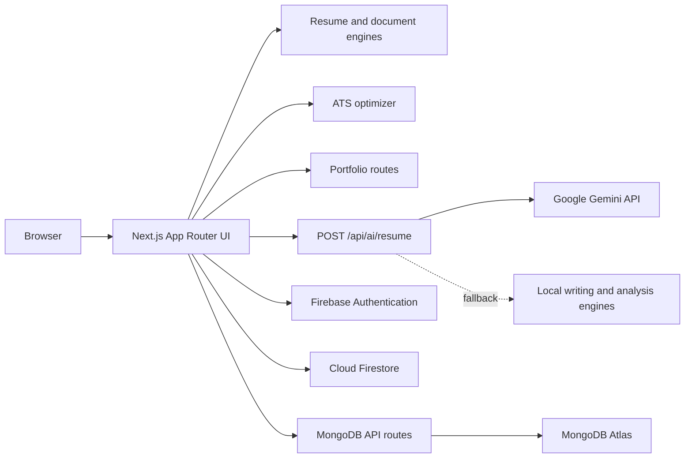

# ResumeBuilderAI 3.0

<div align="center">

**An AI-assisted career workspace for building, analyzing, tailoring, and managing professional job-search documents.**

[](https://nextjs.org/)
[](https://react.dev/)
[](https://www.typescriptlang.org/)
[](https://tailwindcss.com/)

[](https://nodejs.org/)
[](https://firebase.google.com/)
[](https://www.mongodb.com/atlas)
[](https://ai.google.dev/)
[](https://render.com/)

</div>

---

## Table of Contents

- [Overview](#overview)
- [Core Capabilities](#core-capabilities)
- [How the Product Works](#how-the-product-works)
- [Technology Stack](#technology-stack)
- [System Architecture](#system-architecture)
- [Project Structure](#project-structure)
- [Getting Started](#getting-started)
- [Environment Configuration](#environment-configuration)
- [Available Scripts](#available-scripts)
- [API Reference](#api-reference)
- [Data and Persistence](#data-and-persistence)
- [Security and Privacy](#security-and-privacy)
- [Deployment](#deployment)
- [Testing and Quality](#testing-and-quality)
- [Performance and Accessibility](#performance-and-accessibility)
- [Known Limitations](#known-limitations)
- [Roadmap](#roadmap)
- [Contributing](#contributing)
- [Documentation](#documentation)
- [Maintainer](#maintainer)
- [License](#license)

---

## Overview

**ResumeBuilderAI 3.0** is a full-stack, browser-based career platform built with the Next.js App Router. It combines a live resume editor, job-description matching, AI-assisted writing, cover-letter tools, job and interview planning, portfolio publishing, and document management in one workspace.

The application is designed around three use cases:

1. **Create** structured resumes with template, typography, spacing, color, and section controls.
2. **Optimize** resume content against a target role with transparent, heuristic ATS feedback.
3. **Manage** the complete application journey through job tracking, interview preparation, career mapping, and public portfolios.

This repository contains the complete application interface and supporting engines. Firebase, MongoDB, and Gemini credentials are optional external integrations; the project can be run without them by using local and fallback behavior where implemented.

> **ATS scores are heuristic guidance, not predictions of hiring decisions or guarantees of compatibility with every Applicant Tracking System.**

---

## Core Capabilities

### Resume Builder

- Real-time A4 and US Letter resume preview
- 18 resume templates across executive, professional, technical, academic, creative, simple, and student categories
- Structured fields for experience, education, skills, projects, certifications, languages, awards, volunteering, publications, and custom sections
- Theme color, font family, font size, line spacing, and page-margin controls
- Reorderable sections
- Undo and redo history
- Selectable PDF-print workflow
- Plain-text and JSON export
- LinkedIn text/JSON and document-import workflows
- Version snapshots within the resume document model

### ATS and Job-Match Analysis

- Resume and job-description text comparison
- Keyword and skill coverage analysis
- Quantified-impact and formatting-readability checks
- Title and summary relevance feedback
- Action-verb and critical-skill recommendations
- Ranked matched and missing keywords
- Suggested headline, summary, and bullet improvements
- Transparent score breakdown and a non-guarantee disclaimer

### AI Writing Assistance

- Server-side Gemini integration for supported resume operations
- Tailored resume, guided draft, and cover-letter generation paths
- Prompt delimiters and sanitization for untrusted resume or job-description text
- Graceful fallback behavior when `GEMINI_API_KEY` is not configured
- Local bullet-rewriting and resume-analysis engines for core functionality

### Cover Letter Studio

- Dedicated cover-letter document model
- Recipient, company, role, date, and body-content controls
- Optional association with an existing resume
- Template and typography settings
- Print and export-ready rendering

### Job and Career Management

- Job board and application tracker
- Saved, interested, applied, assessment, interviewing, offer, rejected, and archived application stages
- Interview preparation workspace with role-focused and STAR-style guidance
- Career map and skills-gap planning
- Career-intelligence views
- Application notes, statuses, and document associations

### Portfolio and Media

- Editable public portfolio data
- Portfolio theme and visual-style selection
- Slug-based public route at `/p/[slug]`
- Profile, project, cover-page, and media assets
- Cover-page designer
- Video pitch and link-based media presentation

### Account and Workspace

- Firebase Authentication support
- Google, GitHub, and LinkedIn OAuth provider setup
- Optional Firebase email/password authentication
- PBKDF2-SHA256 local credential fallback
- Firestore-backed user documents
- Responsive navigation and adaptive layout behavior
- Browser and JSON data export flows
- Account and local workspace cleanup flows

---

## How the Product Works



### Resume creation flow

1. The user creates or imports a resume.
2. The document is normalized into the `ResumeDocument` model.
3. The editor updates the in-browser document state.
4. The live canvas renders the selected template and typography settings.
5. ATS and AI engines analyze or transform the document.
6. The document can be exported or synchronized to a configured persistence provider.

### AI request flow

1. The browser sends an operation request to `/api/ai/resume`.
2. The server validates and normalizes the input.
3. `GEMINI_API_KEY` is read only from the server environment.
4. Gemini performs the requested operation when configured.
5. If credentials are absent or the provider is unavailable, supported local fallback behavior is used.

### Data flow

- **Without external services:** core editor and analysis features can work locally in the browser or server process.
- **With Firebase:** authenticated users can synchronize Firestore user, resume, cover-letter, and job records.
- **With MongoDB:** the API routes can check and synchronize data through a MongoDB Atlas connection pool.
- **With Gemini:** server-side AI features can use the Gemini API.

---

## Technology Stack

| Area | Technology |
| --- | --- |
| Framework | Next.js 15 App Router |
| UI | React 19 |
| Language | TypeScript 5.9 |
| Styling | Tailwind CSS 4 |
| Animation | Motion |
| Icons | Lucide React |
| AI provider | Google Gemini through `@google/genai` |
| Authentication | Firebase Authentication |
| Document persistence | Cloud Firestore |
| Optional database | MongoDB Atlas through `mongodb` |
| Validation | ESLint and TypeScript |
| Testing | Node.js test runner with `tsx --test` |
| Deployment | Standalone Next.js output on Render |

---

## System Architecture

### Application layers

| Layer | Responsibility |
| --- | --- |
| App Router pages | Route handling, page-level composition, metadata, and public portfolio rendering |
| Dashboard components | Workspace navigation and feature modules |
| Resume components | Three-panel editing, live canvas preview, import, export, and template controls |
| Core libraries | Resume schema, ATS matching, AI rewriting, parsing, authentication, persistence, security, and PDF utilities |
| API routes | Server-only AI, authentication recording, health checks, MongoDB, and engineering insights |
| External services | Firebase, Gemini, and MongoDB Atlas |

### Public application routes

| Route | Purpose |
| --- | --- |
| `/` | Landing page and product overview |
| `/dashboard` | Main career workspace |
| `/ats-checker` | Resume and job-description analysis |
| `/career-map` | Career planning interface |
| `/cover-letter` | Cover-letter workspace |
| `/interview-prep` | Interview practice interface |
| `/p/[slug]` | Public portfolio pages |
| `/templates` | Resume template showcase |

### Server API routes

| Method | Route | Purpose |
| --- | --- | --- |
| `GET` | `/api/health` | Process liveness and deployment health |
| `GET` | `/api/db/health` | MongoDB configuration and connection diagnostics |
| `POST` | `/api/db/sync` | MongoDB synchronization operations |
| `POST` | `/api/ai/resume` | Gemini-backed or local-fallback AI operations |
| `POST` | `/api/auth/record` | Authentication record handling |
| `GET` | `/api/rea-insights` | Engineering and security insight payload |

---

## Project Structure

```text
ResumeBuilderAI3.0/
├── app/
│   ├── api/
│   │   ├── ai/resume/          # Server-side AI operations
│   │   ├── auth/record/        # Authentication record route
│   │   ├── db/health/          # MongoDB health check
│   │   ├── db/sync/            # MongoDB synchronization
│   │   ├── health/             # Deployment liveness endpoint
│   │   └── rea-insights/       # Engineering insight endpoint
│   ├── ats-checker/
│   ├── career-map/
│   ├── cover-letter/
│   ├── dashboard/
│   ├── interview-prep/
│   ├── p/[slug]/               # Public portfolio route
│   ├── templates/
│   └── layout.tsx
├── components/
│   ├── dashboard/              # Workspace feature modules
│   ├── marketing/              # Landing-page sections
│   ├── LandingView.tsx
│   ├── ResumeBuilderApp.tsx
│   ├── ResumeCanvasPreview.tsx
│   └── SelfHealingProvider.tsx
├── lib/
│   ├── ats-optimizer.ts        # Resume/job-description matching
│   ├── ai-bullet-rewriter.ts   # Local AI-writing assistance
│   ├── auth-service.ts
│   ├── authenticated-fetch.ts
│   ├── firebase.ts
│   ├── firestore-service.ts
│   ├── linkedin-parser.ts
│   ├── mongodb.ts
│   ├── pdf-print-engine.ts
│   ├── resume-engine.ts
│   ├── security-utils.ts
│   └── self-healing-engine.ts
├── docs/
├── public/
├── scripts/
├── firestore.rules
├── render.yaml
├── package.json
└── .env.example
```

---

## Getting Started

### Prerequisites

- Node.js `24.x`
- npm `10` or newer
- A modern browser
- Optional: a Firebase project
- Optional: a MongoDB Atlas cluster
- Optional: a Google Gemini API key

The Node.js requirement is declared in `.node-version`, `package.json`, and the environment template.

### Local setup

```bash
# 1. Clone the repository
git clone https://github.com/abhijit869/ResumeBuilderAI3.0.git
cd ResumeBuilderAI3.0

# 2. Install dependencies
npm ci

# 3. Create a local environment file
cp .env.example .env.local

# 4. Start the development server
npm run dev
```

Open `http://localhost:3000`.

The first run does not require external credentials. Configure integrations only as needed.

---

## Environment Configuration

Create `.env.local` from `.env.example`.

| Variable | Required | Purpose |
| --- | --- | --- |
| `GEMINI_API_KEY` | No | Enables server-side Gemini AI operations |
| `APP_URL` | No | Canonical application URL used for public links |
| `MONGODB_URI` | No | MongoDB Atlas connection string |
| `MONGODB_DB_NAME` | No | MongoDB database name |
| `NEXT_PUBLIC_FIREBASE_EMAIL_AUTH_ENABLED` | No | Enables Firebase email/password auth |
| `NEXT_PUBLIC_FIREBASE_PROJECT_ID` | No | Firebase project override |
| `NEXT_PUBLIC_FIREBASE_APP_ID` | No | Firebase web app override |
| `NEXT_PUBLIC_FIREBASE_API_KEY` | No | Firebase web API key override |
| `NEXT_PUBLIC_FIREBASE_AUTH_DOMAIN` | No | Firebase Auth domain override |
| `NEXT_PUBLIC_FIREBASE_DATABASE_ID` | No | Firestore database ID override |
| `NEXT_PUBLIC_FIREBASE_STORAGE_BUCKET` | No | Firebase Storage bucket override |
| `NEXT_PUBLIC_FIREBASE_MESSAGING_SENDER_ID` | No | Firebase messaging sender override |
| `NEXT_PUBLIC_FIREBASE_OAUTH_CLIENT_ID` | No | OAuth client override |
| `FIREBASE_AUTH_API_KEY` | No | Server-compatible Firebase Identity Toolkit key |
| `DISABLE_HMR` | No | Disables development hot reload when set to `true` |

### Configuration notes

- Never prefix a secret such as `GEMINI_API_KEY` or `MONGODB_URI` with `NEXT_PUBLIC_`.
- Do not commit `.env.local` or real credentials.
- The repository includes Firebase configuration fallbacks for the configured environment.
- Firebase email/password authentication is disabled by default unless explicitly enabled.
- MongoDB routes report not-configured or unavailable states when no valid connection is supplied.

---

## Available Scripts

| Command | Description |
| --- | --- |
| `npm run dev` | Start the Next.js development server |
| `npm run build` | Create a production build |
| `npm run start` | Start the built application |
| `npm run lint` | Run ESLint across the repository |
| `npm run typecheck` | Run TypeScript without emitting files |
| `npm test` | Run unit and utility tests |
| `npm run test:routes` | Check application routes against a running server |
| `npm run test:api` | Run API and security verification checks |
| `npm run db:seed` | Run the MongoDB seed script |
| `npm run db:health` | Call the local MongoDB health endpoint |
| `npm run build:render` | Build and prepare standalone output for Render |
| `npm run clean` | Remove the local `.next` build directory |

---

## API Reference

### Health

```http
GET /api/health
```

Returns the process liveness response used by deployment health checks.

### MongoDB health

```http
GET /api/db/health
```

Reports whether MongoDB is configured and whether a connection can be established.

### MongoDB synchronization

```http
POST /api/db/sync
Content-Type: application/json
```

The request and response contract is implemented in `app/api/db/sync/route.ts`. Treat the response as environment-dependent because synchronization requires MongoDB configuration.

### AI resume operations

```http
POST /api/ai/resume
Content-Type: application/json
```

Supported operations are handled server-side and include tailored resume, guided drafting, and cover-letter paths. Gemini credentials remain on the server. A fallback is used when Gemini is unavailable or not configured.

### Authentication record

```http
POST /api/auth/record
Content-Type: application/json
```

Handles authentication record synchronization. Actual cloud behavior depends on Firebase configuration.

---

## Data and Persistence

### Firebase

Cloud Firestore is organized around authenticated user ownership. The rules in `firestore.rules`:

- Default-deny unrelated document access
- Require Firebase authentication
- Restrict user records to the matching UID
- Validate document IDs and fields
- Prevent immutable ownership identifiers from being changed
- Deny directory-style listing of all users

Private collections include user resumes, cover letters, and job applications.

### MongoDB

`lib/mongodb.ts` implements a cached MongoDB client for Next.js server processes, with a bounded connection pool and MongoDB Atlas-oriented defaults.

MongoDB integration is optional and is not a substitute for the browser's Firebase feature configuration. The database route set exposes health and synchronization behavior.

### Local fallback

The application includes a browser-side/local experience for core editing and analysis. Local fallback authentication and storage do not create a cloud session or cloud-persisted records.

---

## Security and Privacy

Security-sensitive areas implemented in the repository include:

- Default-deny Firestore rules
- Owner UID checks for user-scoped records
- Field and identifier validation in Firestore rules
- HTML entity escaping for export or render boundaries
- External URL validation and blocked private-network destinations
- Prompt sanitization and delimiter neutralization
- Server-side Gemini credential handling
- PBKDF2-SHA256 password hashing with a per-user salt
- JSON account-data export and account deletion flows
- Security and engineering insight routes
- Deployment health checks

Before storing sensitive information in production, review:

- Firebase project rules and authorized domains
- Provider enablement and OAuth redirect configuration
- MongoDB network-access and database-user restrictions
- Server-only environment variables
- Logging and secret-management policies
- An independent security review of authentication and persistence behavior

No ATS result, AI output, or export should be interpreted as legally binding, guaranteed, or factually verified without human review.

---

## Deployment

The repository includes `render.yaml` for a Node.js web service on Render.

The Blueprint configures:

- A production build with development dependencies
- Standalone Next.js output
- `node .next/standalone/server.js`
- `/api/health` as the health-check route
- Firebase email/password environment defaults
- Protected Gemini and MongoDB environment variables

### Render deployment checklist

1. Create or update the Render service from `render.yaml`.
2. Set `GEMINI_API_KEY` if Gemini AI is needed.
3. Set `MONGODB_URI` and `MONGODB_DB_NAME` if MongoDB is needed.
4. Set `APP_URL` or configure the public canonical URL.
5. Configure Firebase providers and authorized domains.
6. Set the public Firebase environment variables for the deployed project.
7. Deploy `firestore.rules` to the same Firebase project.
8. Verify `/api/health`.
9. Verify `/api/db/health` if MongoDB is enabled.
10. Test authentication, resume persistence, AI fallback, and portfolio routes.

Detailed guidance is available in:

- `docs/render-deployment.md`
- `docs/render-verification.md`
- `docs/security-checklist.md`

---

## Testing and Quality

### Standard validation

```bash
npm run typecheck
npm run lint
npm test
npm run build
```

### Route verification

With the development or production server running:

```bash
BASE_URL=http://localhost:3000 npm run test:routes
BASE_URL=http://localhost:3000 npm run test:api
```

The repository includes tests for resume, ATS, AI rewriting, parsing, MongoDB, authentication security, and adaptive-layout utilities. The test suite is in `lib/**/*.test.ts` and is run by `tsx --test`.

---

## Performance and Accessibility

The implementation includes:

- Server-rendered Next.js pages
- Standalone deployment output
- Responsive layouts
- Browser viewport classification
- Adaptive typography and fluid contrast utilities
- Touch-target constraints
- A self-healing environment provider
- Lazy loading and modular workspace components

Because accessibility behavior varies by browser and document content, validate keyboard navigation, contrast, zoom, screen-reader output, and print layout before a production release.

---

## Known Limitations

- ATS analysis is rule-based and heuristic; it does not guarantee screening success.
- Gemini output depends on provider availability and valid credentials.
- External Firebase and MongoDB services require correct project configuration.
- Firebase and MongoDB are separate integrations and are not automatically interchangeable.
- Public portfolio publishing requires its route and persistence behavior to be configured and tested.
- PDF output is browser print/export oriented and can vary slightly across browsers and operating systems.
- Import quality depends on source document structure and parsable text.
- AI-generated content must be reviewed for factual accuracy and original phrasing.
- Job, interview, and career recommendations are guidance and not employment or legal advice.

---

## Roadmap

The following items are suitable project goals, but should not be described as already completed unless implemented and verified:

- Expand automated browser and end-to-end coverage
- Add repeatable visual and PDF regression tests
- Improve document parsing for additional formats
- Add localization and international resume conventions
- Expand template and cover-letter catalog
- Improve portfolio publishing and custom-domain support
- Add richer application analytics and reminders
- Provide export integrations such as DOCX and PDF generation
- Strengthen production observability and audit logging

---

## Contributing

Contributions are welcome.

```bash
# Fork the repository, then create a branch
git checkout -b feature/your-feature

# Run the relevant checks
npm run typecheck
npm run lint
npm test
npm run build

# Commit and open a pull request
git commit -m "Add: concise feature description"
git push origin feature/your-feature
```

Please keep changes focused, update directly related documentation, add tests for new behavior, and never commit credentials or `.env.local`.

---

## Documentation

| Document | Description |
| --- | --- |
| `docs/architecture.md` | System architecture and design principles |
| `docs/feature-matrix.md` | Feature implementation matrix |
| `docs/api-integrations.md` | External API integration notes |
| `docs/database-schema.md` | Firestore and database model documentation |
| `docs/security-checklist.md` | Security review checklist |
| `docs/qa-report.md` | QA report |
| `docs/implementation-roadmap.md` | Planned implementation work |
| `docs/final-release-audit.md` | Release audit and verification notes |
| `docs/render-deployment.md` | Render deployment guide |
| `docs/render-verification.md` | Render verification steps |
| `docs/ui-ux-redesign-report.md` | UI and UX redesign report |

---

## Maintainer

**Abhijit Biswas**

- GitHub: [@abhijit869](https://github.com/abhijit869)
- Repository: [ResumeBuilderAI3.0](https://github.com/abhijit869/ResumeBuilderAI3.0)

---

## License

A license file is not currently identified in this repository. Add an appropriate `LICENSE` file before distributing or publishing the project under specific terms.
